# CTAS y tablas temporales en SQL Server

Prácticas sobre SonoraDB · Sesión 1 (CTAS) y Sesión 2 (tablas temporales)

Álvaro García-Quismondo Lizana · Máster en IA y Big Data · Tajamar · 12 de octubre de 2026

Entorno: SQL Server 2022 (16.0) local, SSMS, base de datos SonoraDB. Las capturas están en `img/` y cada script en `sql/` con el mismo nombre que su ejercicio.

## Índice

1. Sesión 1 · CTAS (CREATE TABLE AS SELECT)
   - 1.1 Preparación
   - 1.2 Ejercicio 1. Copia completa de artistas
   - 1.3 Ejercicio 2. Usuarios de Latinoamérica
   - 1.4 Ejercicio 3. Tabla de staging vacía
   - 1.5 Ejercicio 4. Anuncios emitidos
   - 1.6 Ejercicio 5. Cruce de países usuario y artista
   - 1.7 Ejercicio 6. Ficha de canciones
   - 1.8 Ejercicio 7. Seguimiento de lanzamientos
   - 1.9 Ejercicio 8. Catálogo completo
   - 1.10 Ejercicio 9. Actividad de usuarios
   - 1.11 Ejercicio 10. Organigrama plano
   - 1.12 Ejercicio 11. Personas por país
   - 1.13 Ejercicio 12. Foto de usuarios por plan
   - 1.14 Ejercicio 13. Ranking de artistas con intercambio
2. Sesión 2 · Tablas temporales
   - 2.1 Punto de partida
   - 2.2 Tabla base #validas_semana
   - 2.3 Ejercicio 1. Lanzamientos de 2026
   - 2.4 Ejercicio 2. Usuarios de pago
   - 2.5 Ejercicio 3. Script de Hugo
   - 2.6 Ejercicio 4. Alcance de # y @
   - 2.7 Ejercicio 5. Reproducciones válidas del histórico
   - 2.8 Ejercicio 6. Royalties con @tarifas
   - 2.9 Ejercicio 7. Catálogo por formato
   - 2.10 Ejercicio 8. Tabla global ##artistas_semana
   - 2.11 Ejercicio 9. Transacciones: # frente a @
   - 2.12 Ejercicio 10. Árbol de géneros
   - 2.13 Ejercicio 11. Aterrizar el lote de novedades
   - 2.14 Ejercicio 12. Validar y cargar las novedades

## 1. Sesión 1 · CTAS (CREATE TABLE AS SELECT)

En T-SQL el CTAS se escribe como SELECT ... INTO. Todos los scripts empiezan con DROP TABLE IF EXISTS para poder ejecutarse varias veces, y las columnas calculadas llevan alias y CAST para controlar la estructura que crea el motor.

### 1.1 Preparación

*Comprobar el punto de partida de la clase: 43 reproducciones y 10 usuarios.*

Script: [`sql/s1_prep.sql`](sql/s1_prep.sql)

```sql
USE SonoraDB;
GO

SELECT (SELECT COUNT(*) FROM dbo.reproducciones) AS reproducciones,
       (SELECT COUNT(*) FROM dbo.usuarios)       AS usuarios;
```

Las cargas de las clases anteriores ya estaban aplicadas, así que solo ejecuté la comprobación final del script de preparación. Devuelve 43 reproducciones y 10 usuarios, que es el punto de partida que exige la práctica.

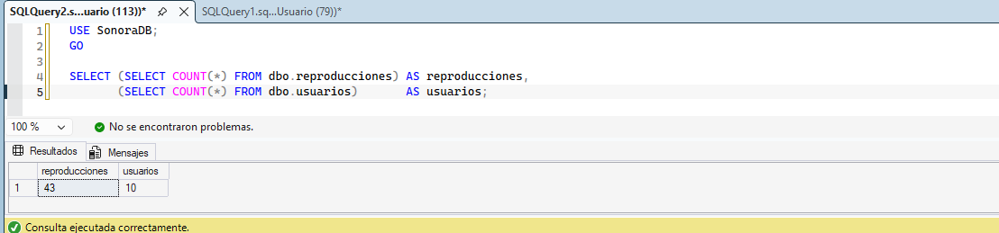

Figura 1. Comprobación del punto de partida de la sesión 1

### 1.2 Ejercicio 1. Copia completa de artistas

*Crear una copia completa de artistas en artistas_copia y comprobar cuántas filas tiene.*

Script: [`sql/s1_ej01.sql`](sql/s1_ej01.sql)

```sql
DROP TABLE IF EXISTS dbo.artistas_copia;

SELECT *
INTO dbo.artistas_copia
FROM dbo.artistas;

SELECT COUNT(*) AS filas FROM dbo.artistas_copia;
```

Con SELECT ... INTO la tabla se crea y se carga en una sola instrucción. Antepuse DROP TABLE IF EXISTS para que el script pueda ejecutarse varias veces sin el error 2714. La copia tiene las 9 filas de la tabla original y sirve como respaldo antes de que el equipo de catálogo corrija nombres a mano.

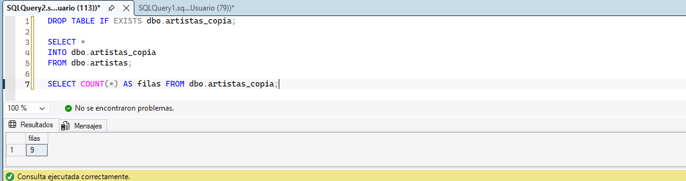

Figura 2. Copia de artistas con 9 filas

### 1.3 Ejercicio 2. Usuarios de Latinoamérica

*Crear usuarios_latam con identificador, nombre, país y plan de los usuarios de MX, AR, CO y PR.*

Script: [`sql/s1_ej02.sql`](sql/s1_ej02.sql)

```sql
DROP TABLE IF EXISTS dbo.usuarios_latam;

SELECT usuario_id, nombre_usuario, pais, plan_suscripcion
INTO dbo.usuarios_latam
FROM dbo.usuarios
WHERE pais IN ('MX', 'AR', 'CO', 'PR');

SELECT usuario_id, nombre_usuario, pais, plan_suscripcion
FROM dbo.usuarios_latam
ORDER BY pais, nombre_usuario;
```

La lista de columnas del SELECT decide qué columnas tiene la tabla nueva, y el WHERE decide qué filas entran. Dejé fuera el email y la fecha de alta. El resultado son los 6 usuarios esperados. El ORDER BY va en la consulta final, porque una tabla no guarda orden.

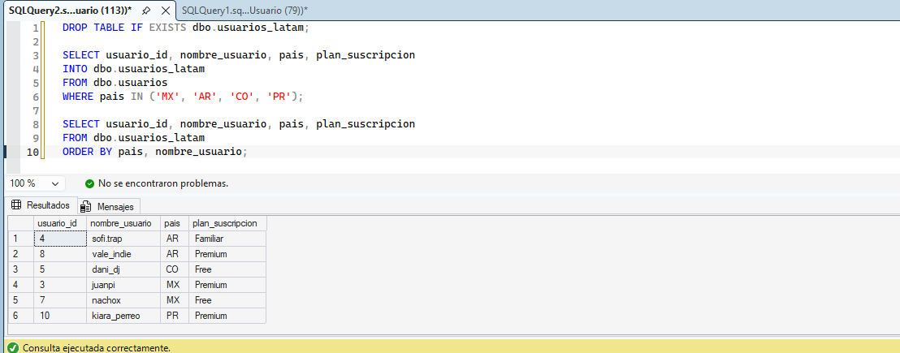

Figura 3. Usuarios de los mercados de Latinoamérica

### 1.4 Ejercicio 3. Tabla de staging vacía

*Crear stg_usuarios_2309 vacía, con las mismas columnas que usuarios, y responder dos preguntas sobre sus restricciones.*

Script: [`sql/s1_ej03.sql`](sql/s1_ej03.sql)

```sql
DROP TABLE IF EXISTS dbo.stg_usuarios_2309;

SELECT *
INTO dbo.stg_usuarios_2309
FROM dbo.usuarios
WHERE 1 = 0;

SELECT COUNT(*) AS filas FROM dbo.stg_usuarios_2309;

SELECT COLUMN_NAME, DATA_TYPE, IS_NULLABLE
FROM INFORMATION_SCHEMA.COLUMNS
WHERE TABLE_SCHEMA = N'dbo' AND TABLE_NAME = N'stg_usuarios_2309'
ORDER BY ORDINAL_POSITION;
```

La condición WHERE 1 = 0 no devuelve filas, pero el SELECT define igualmente las columnas. La tabla queda con 0 filas y las seis columnas de usuarios.

Sí se podría insertar dos veces una fila con usuario_id = 1: el CTAS no copia la clave primaria, así que nada impide los duplicados.

No se podría insertar una fila con el email a NULL. Las columnas copiadas tal cual heredan el NOT NULL, como se ve en la columna IS_NULLABLE (NO para email), y el INSERT fallaría con el error 515.

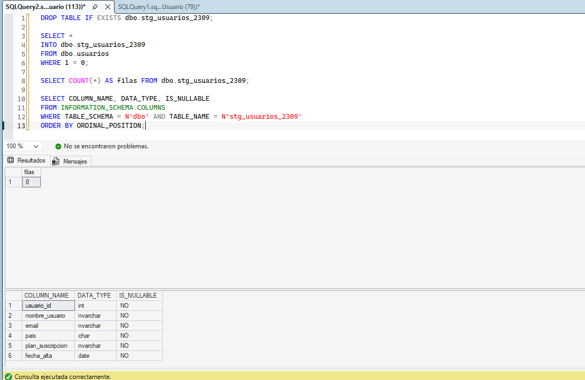

Figura 4. Tabla vacía y estructura heredada de usuarios

### 1.5 Ejercicio 4. Anuncios emitidos

*Crear anuncios_emitidos con las reproducciones de tipo Anuncio, en un script re-ejecutable.*

Script: [`sql/s1_ej04.sql`](sql/s1_ej04.sql)

```sql
DROP TABLE IF EXISTS dbo.anuncios_emitidos;

SELECT reproduccion_id, usuario_id, fecha_hora, dispositivo
INTO dbo.anuncios_emitidos
FROM dbo.reproducciones
WHERE tipo_contenido = N'Anuncio';

SELECT reproduccion_id, usuario_id, fecha_hora, dispositivo
FROM dbo.anuncios_emitidos
ORDER BY reproduccion_id;
```

Ejecuté el script dos veces seguidas. La segunda ejecución no da error porque el DROP TABLE IF EXISTS borra la tabla anterior antes de volver a crearla. La captura corresponde a la segunda ejecución y muestra los 6 anuncios.

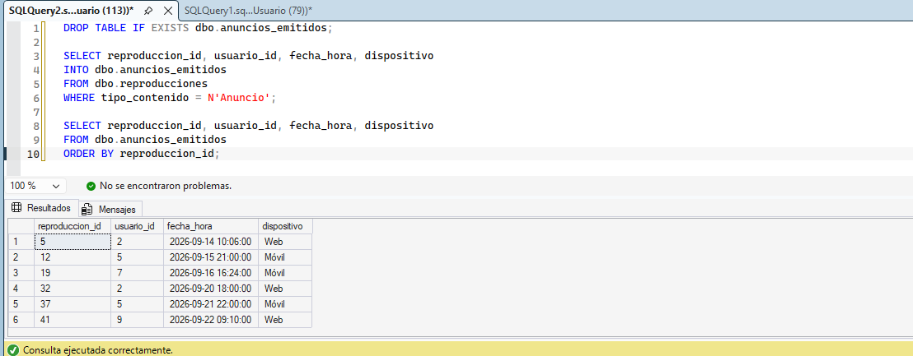

Figura 5. Anuncios emitidos tras la segunda ejecución

### 1.6 Ejercicio 5. Cruce de países usuario y artista

*Explicar los dos problemas del CTAS del compañero, corregirlo y mostrar las 5 combinaciones con más reproducciones.*

Script: [`sql/s1_ej05.sql`](sql/s1_ej05.sql)

```sql
-- Script original (falla)
SELECT u.pais, a.pais, COUNT(*)
INTO dbo.cruce_paises
FROM dbo.reproducciones AS r
JOIN dbo.usuarios  AS u ON u.usuario_id = r.usuario_id
JOIN dbo.canciones AS c ON c.cancion_id = r.cancion_id
JOIN dbo.artistas  AS a ON a.artista_id = c.artista_id
WHERE r.tipo_contenido = N'Canción'
  AND r.segundos_escuchados >= 30
GROUP BY u.pais, a.pais;

-- Script corregido
DROP TABLE IF EXISTS dbo.cruce_paises;

SELECT u.pais   AS pais_usuario,
       a.pais   AS pais_artista,
       COUNT(*) AS reproducciones
INTO dbo.cruce_paises
FROM dbo.reproducciones AS r
JOIN dbo.usuarios  AS u ON u.usuario_id = r.usuario_id
JOIN dbo.canciones AS c ON c.cancion_id = r.cancion_id
JOIN dbo.artistas  AS a ON a.artista_id = c.artista_id
WHERE r.tipo_contenido = N'Canción'
  AND r.segundos_escuchados >= 30
GROUP BY u.pais, a.pais;

SELECT COUNT(*) AS filas FROM dbo.cruce_paises;

SELECT TOP (5) pais_usuario, pais_artista, reproducciones
FROM dbo.cruce_paises
ORDER BY reproducciones DESC, pais_usuario, pais_artista;
```

El script tiene dos problemas. El primero es que COUNT(*) no lleva alias: en una consulta suelta SSMS lo muestra como columna sin nombre, pero una tabla no puede tener columnas sin nombre. Es el error 1038 que aparece al ejecutarlo.

El segundo es que u.pais y a.pais producen dos columnas llamadas pais, y los nombres de columna de una tabla deben ser únicos (error 2705). SQL Server solo informó del primero, pero corrigiendo solo el alias de COUNT(*) aparecería este.

La corrección consiste en dar un alias a cada columna: pais_usuario, pais_artista y reproducciones. La tabla resultante tiene 16 filas y el top 5 coincide con el esperado.

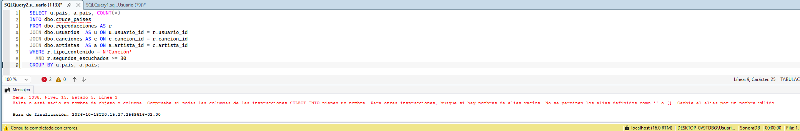

Figura 6. Error 1038 al ejecutar el script original

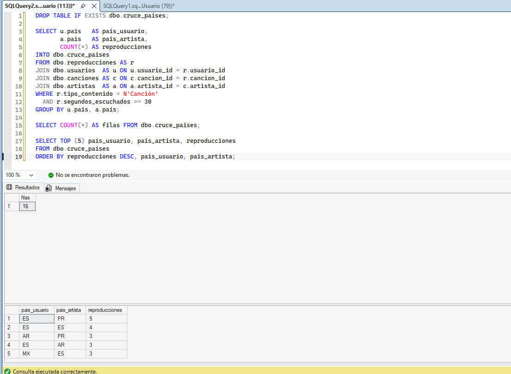

Figura 7. Tabla corregida: 16 combinaciones y top 5

### 1.7 Ejercicio 6. Ficha de canciones

*Crear canciones_ficha con la duración en minutos (decimal(4,1)) y una categoría (nvarchar(10)).*

Script: [`sql/s1_ej06.sql`](sql/s1_ej06.sql)

```sql
DROP TABLE IF EXISTS dbo.canciones_ficha;

SELECT cancion_id,
       titulo,
       CAST(duracion_seg / 60.0 AS decimal(4,1)) AS duracion_min,
       CAST(CASE WHEN duracion_seg >= 300 THEN N'Larga'
                 WHEN duracion_seg >= 180 THEN N'Media'
                 ELSE N'Corta' END AS nvarchar(10)) AS categoria
INTO dbo.canciones_ficha
FROM dbo.canciones;

SELECT COLUMN_NAME, DATA_TYPE, CHARACTER_MAXIMUM_LENGTH, NUMERIC_PRECISION, NUMERIC_SCALE
FROM INFORMATION_SCHEMA.COLUMNS
WHERE TABLE_SCHEMA = N'dbo' AND TABLE_NAME = N'canciones_ficha'
ORDER BY ORDINAL_POSITION;

SELECT categoria, COUNT(*) AS canciones
FROM dbo.canciones_ficha
GROUP BY categoria
ORDER BY categoria;
```

Las dos columnas calculadas llevan CAST con el tipo pedido. Sin él, la división entre 60.0 habría creado un numeric con seis decimales, y el CASE un nvarchar con la longitud del literal más largo. INFORMATION_SCHEMA.COLUMNS confirma decimal(4,1) y nvarchar(10), y el recuento da 4 cortas, 4 largas y 7 medias.

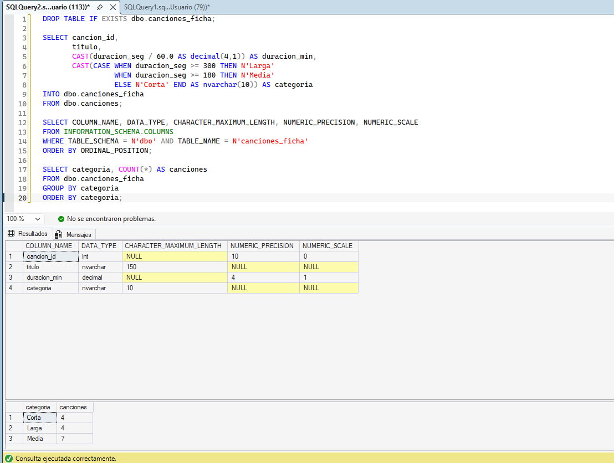

Figura 8. Tipos creados y recuento por categoría

### 1.8 Ejercicio 7. Seguimiento de lanzamientos

*Crear seguimiento_lanzamientos con tres columnas de seguimiento y registrar la revisión de Galaxia Dembow.*

Script: [`sql/s1_ej07.sql`](sql/s1_ej07.sql)

```sql
DROP TABLE IF EXISTS dbo.seguimiento_lanzamientos;

SELECT cancion_id,
       titulo,
       fecha_lanzamiento,
       CAST(N'Sin revisar' AS nvarchar(30)) AS estado,
       CAST(NULL AS nvarchar(100))          AS revisado_por,
       CAST(NULL AS date)                   AS fecha_revision
INTO dbo.seguimiento_lanzamientos
FROM dbo.canciones
WHERE fecha_lanzamiento >= '2026-08-01';

UPDATE dbo.seguimiento_lanzamientos
SET estado         = N'Revisado: apta para portada',
    revisado_por   = N'Carmen Lozano',
    fecha_revision = '2026-09-23'
WHERE titulo = N'Galaxia Dembow';

SELECT cancion_id, titulo, fecha_lanzamiento, estado, revisado_por, fecha_revision
FROM dbo.seguimiento_lanzamientos
ORDER BY fecha_lanzamiento;
```

Es el caso de la caja a medida. Sin CAST, el literal 'Sin revisar' crearía un nvarchar(11) y el texto 'Revisado: apta para portada' no cabría. Un NULL sin tipo se crea como int, y la fecha de revisión fallaría. Con los CAST la tabla admite los valores del UPDATE y la revisión queda registrada sin errores.

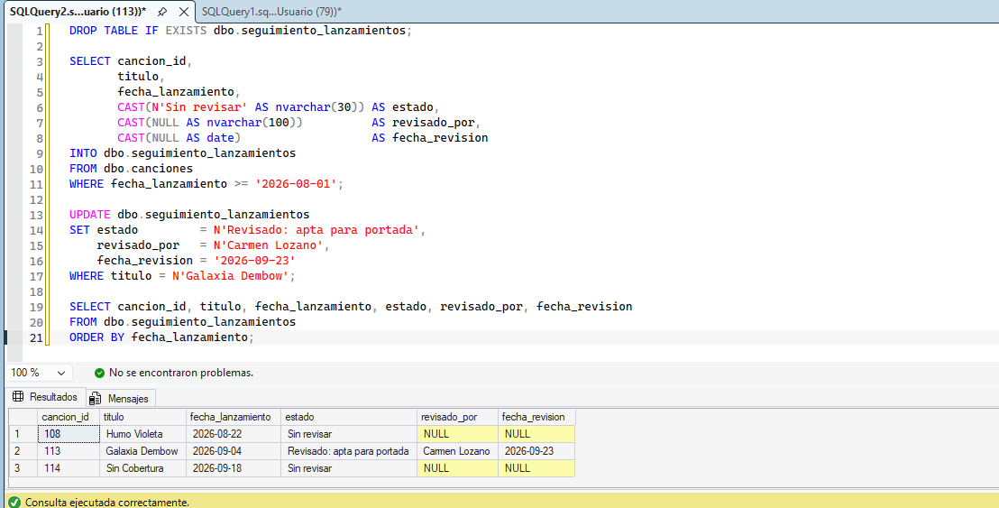

Figura 9. Lanzamientos con la revisión de Galaxia Dembow

### 1.9 Ejercicio 8. Catálogo completo

*Crear catalogo_completo con artista, país, género y género padre, y contar canciones por género padre.*

Script: [`sql/s1_ej08.sql`](sql/s1_ej08.sql)

```sql
DROP TABLE IF EXISTS dbo.catalogo_completo;

SELECT c.cancion_id,
       c.titulo,
       a.nombre  AS artista,
       a.pais    AS pais_artista,
       g.nombre  AS genero,
       gp.nombre AS genero_padre
INTO dbo.catalogo_completo
FROM dbo.canciones AS c
JOIN dbo.artistas  AS a  ON a.artista_id = c.artista_id
JOIN dbo.generos   AS g  ON g.genero_id  = c.genero_id
LEFT JOIN dbo.generos AS gp ON gp.genero_id = g.genero_padre_id;

SELECT genero_padre, COUNT(*) AS canciones
FROM dbo.catalogo_completo
GROUP BY genero_padre
ORDER BY canciones DESC, genero_padre;
```

La tabla generos aparece dos veces: una para el género de la canción y otra, con alias gp, para su género padre. Los alias en artista, genero y genero_padre evitan nombres repetidos. El recuento se hace solo sobre la tabla nueva, sin ningún JOIN, y coincide con el esperado. Las dos canciones con padre Música son las que cuelgan directamente de un género principal.

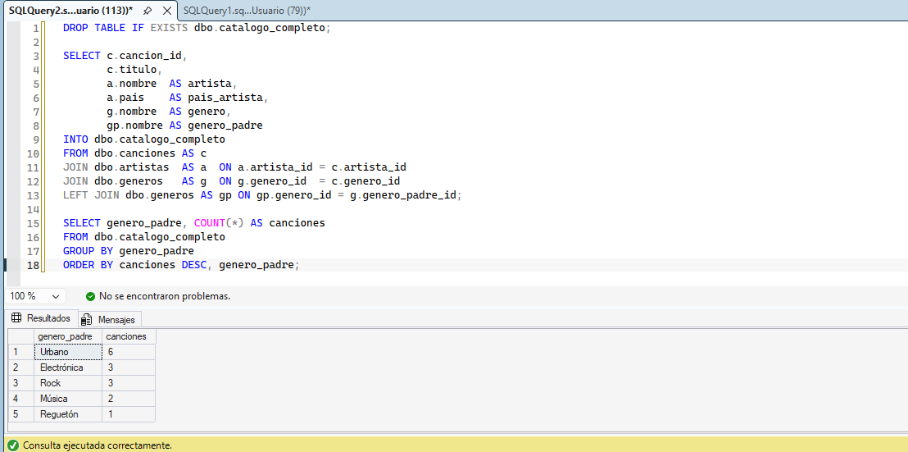

Figura 10. Canciones por género padre

### 1.10 Ejercicio 9. Actividad de usuarios

*Crear actividad_usuarios con válidas, saltos y anuncios por usuario, calculados en una CTE. Deben aparecer los 10 usuarios.*

Script: [`sql/s1_ej09.sql`](sql/s1_ej09.sql)

```sql
DROP TABLE IF EXISTS dbo.actividad_usuarios;

WITH recuentos AS (
    SELECT usuario_id,
           SUM(CASE WHEN tipo_contenido = N'Canción' AND segundos_escuchados >= 30 THEN 1 ELSE 0 END) AS validas,
           SUM(CASE WHEN tipo_contenido = N'Canción' AND segundos_escuchados <  30 THEN 1 ELSE 0 END) AS saltos,
           SUM(CASE WHEN tipo_contenido = N'Anuncio' THEN 1 ELSE 0 END)                                AS anuncios
    FROM dbo.reproducciones
    GROUP BY usuario_id
)
SELECT u.usuario_id,
       u.nombre_usuario,
       u.plan_suscripcion,
       COALESCE(r.validas, 0)  AS validas,
       COALESCE(r.saltos, 0)   AS saltos,
       COALESCE(r.anuncios, 0) AS anuncios
INTO dbo.actividad_usuarios
FROM dbo.usuarios AS u
LEFT JOIN recuentos AS r ON r.usuario_id = u.usuario_id;

SELECT usuario_id, nombre_usuario, plan_suscripcion, validas, saltos, anuncios
FROM dbo.actividad_usuarios
ORDER BY usuario_id;
```

La CTE calcula los tres recuentos con agregación condicional, en una sola pasada sobre reproducciones. La consulta final parte de usuarios con LEFT JOIN, de modo que aparecen los 10 aunque alguno no tuviera reproducciones, y COALESCE convierte esos huecos en 0. El INTO va en el SELECT final, después del WITH.

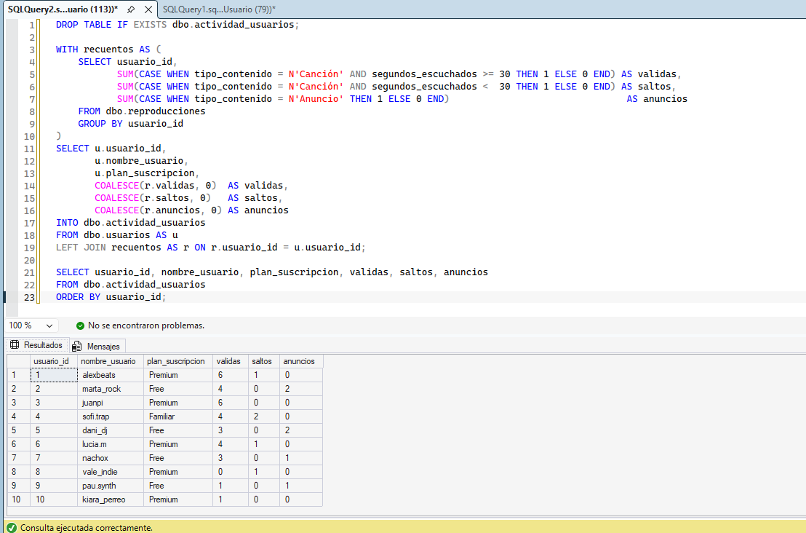

Figura 11. Actividad de los 10 usuarios

### 1.11 Ejercicio 10. Organigrama plano

*Crear organigrama_plano con una CTE recursiva (nivel y ruta) y consultarlo sin recursión.*

Script: [`sql/s1_ej10.sql`](sql/s1_ej10.sql)

```sql
-- Comprobación previa del nombre de la columna del jefe
SELECT TOP (3) * FROM dbo.empleados;

DROP TABLE IF EXISTS dbo.organigrama_plano;

WITH org AS (
    SELECT empleado_id, nombre, puesto,
           0 AS nivel,
           CAST(nombre AS nvarchar(500)) AS ruta
    FROM dbo.empleados
    WHERE jefe_id IS NULL

    UNION ALL

    SELECT e.empleado_id, e.nombre, e.puesto,
           o.nivel + 1,
           CAST(o.ruta + N' > ' + e.nombre AS nvarchar(500))
    FROM dbo.empleados AS e
    JOIN org AS o ON e.jefe_id = o.empleado_id
)
SELECT empleado_id, nombre, puesto, nivel, ruta
INTO dbo.organigrama_plano
FROM org;

-- a)
SELECT nivel, COUNT(*) AS empleados
FROM dbo.organigrama_plano
GROUP BY nivel
ORDER BY nivel;

-- b)
SELECT nombre, puesto, nivel
FROM dbo.organigrama_plano
WHERE ruta LIKE N'%Raúl Benet%'
ORDER BY nivel, nombre;
```

Antes de escribir la CTE comprobé que la columna del responsable se llama jefe_id. El ancla es el CEO (jefe_id a NULL) y la parte recursiva va añadiendo un nivel y el nombre a la ruta. El CAST a nvarchar(500) es necesario porque la parte ancla y la recursiva deben devolver exactamente el mismo tipo.

Una vez guardado, el organigrama se consulta sin recursión. El recuento por nivel da 1, 2, 3 y 4 empleados, y el LIKE sobre la ruta devuelve a Raúl Benet y a las tres personas que dependen de él.

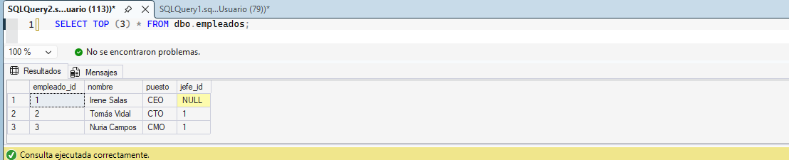

Figura 12. Columnas de empleados

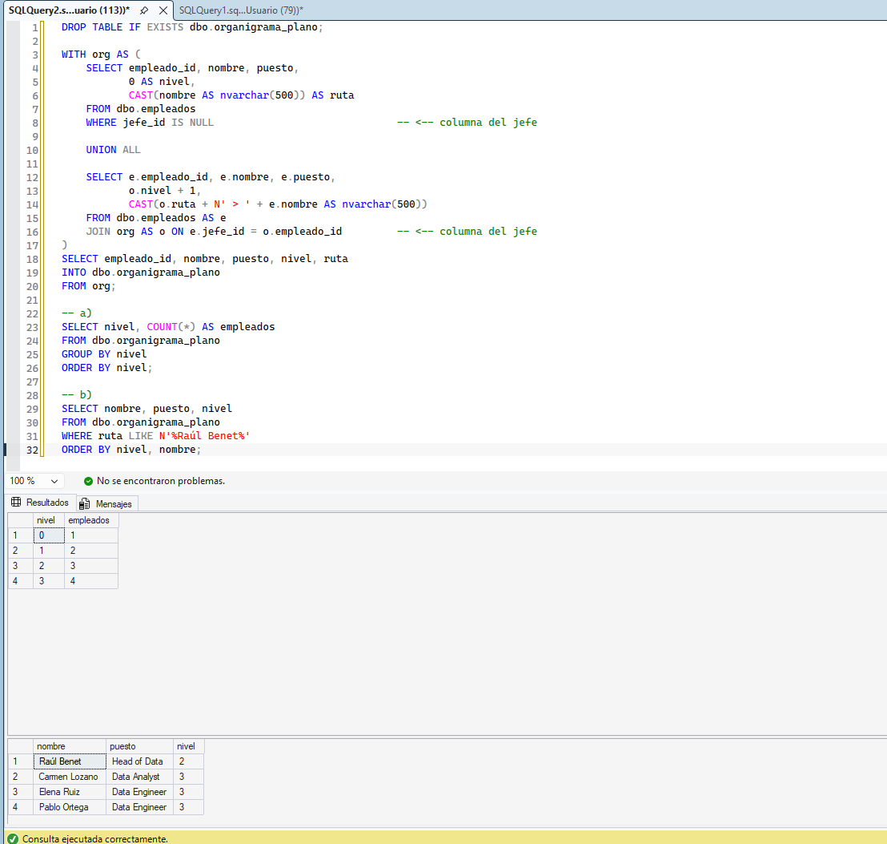

Figura 13. Empleados por nivel y equipo de Raúl Benet

### 1.12 Ejercicio 11. Personas por país

*Crear personas_por_pais uniendo usuarios y artistas con UNION ALL y contar ambos por país.*

Script: [`sql/s1_ej11.sql`](sql/s1_ej11.sql)

```sql
DROP TABLE IF EXISTS dbo.personas_por_pais;

SELECT pais,
       CAST(N'Usuario' AS nvarchar(10)) AS tipo,
       nombre_usuario                   AS nombre
INTO dbo.personas_por_pais
FROM dbo.usuarios
UNION ALL
SELECT pais, N'Artista', nombre
FROM dbo.artistas;

SELECT pais,
       SUM(CASE WHEN tipo = N'Usuario' THEN 1 ELSE 0 END) AS usuarios,
       SUM(CASE WHEN tipo = N'Artista' THEN 1 ELSE 0 END) AS artistas
FROM dbo.personas_por_pais
GROUP BY pais
ORDER BY usuarios DESC, pais;
```

En un UNION ALL el INTO va solo en el primer SELECT, y de ese SELECT salen también los nombres de las columnas. Por eso el CAST a nvarchar(10) y los alias están en la primera parte. El recuento por país se hace con agregación condicional sobre la tabla nueva y coincide con el esperado, incluido Alemania con 0 usuarios y 1 artista.

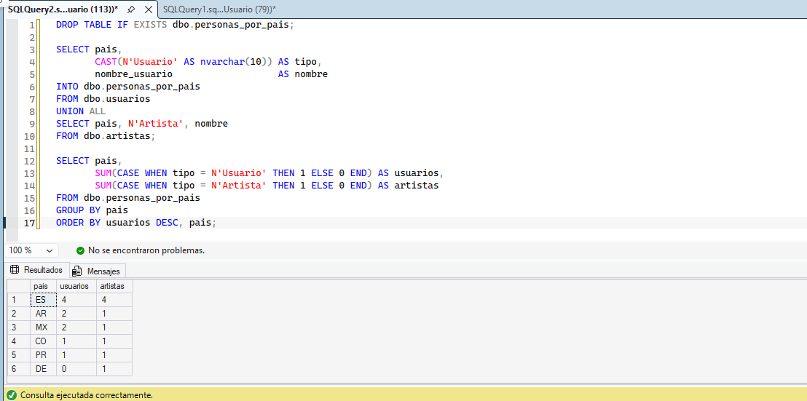

Figura 14. Usuarios y artistas por país

### 1.13 Ejercicio 12. Foto de usuarios por plan

*a) Crear foto_usuarios_plan. b) Pasar a nachox a Premium en una transacción y comparar la foto con el recuento actual antes del ROLLBACK.*

Script: [`sql/s1_ej12.sql`](sql/s1_ej12.sql)

```sql
-- a)
DROP TABLE IF EXISTS dbo.foto_usuarios_plan;

SELECT plan_suscripcion, COUNT(*) AS usuarios
INTO dbo.foto_usuarios_plan
FROM dbo.usuarios
GROUP BY plan_suscripcion;

SELECT plan_suscripcion, usuarios
FROM dbo.foto_usuarios_plan
ORDER BY usuarios DESC;

-- b)
BEGIN TRAN;

UPDATE dbo.usuarios
SET plan_suscripcion = N'Premium'
WHERE nombre_usuario = N'nachox';

WITH ahora AS (
    SELECT plan_suscripcion, COUNT(*) AS usuarios
    FROM dbo.usuarios
    GROUP BY plan_suscripcion
)
SELECT COALESCE(f.plan_suscripcion, a.plan_suscripcion) AS plan_suscripcion,
       COALESCE(f.usuarios, 0) AS usuarios_foto,
       COALESCE(a.usuarios, 0) AS usuarios_ahora
FROM dbo.foto_usuarios_plan AS f
FULL JOIN ahora AS a ON a.plan_suscripcion = f.plan_suscripcion
WHERE COALESCE(f.usuarios, 0) <> COALESCE(a.usuarios, 0)
ORDER BY plan_suscripcion;

ROLLBACK;
```

La foto guarda el recuento del momento en que se crea: 5 Premium, 4 Free y 1 Familiar.

Dentro de la transacción, la CTE ahora recalcula el recuento real y lo cruza con la foto. Usé FULL JOIN para no perder un plan que existiera solo en uno de los dos lados, y el WHERE deja solo los planes que han cambiado: Free baja de 4 a 3 y Premium sube de 5 a 6. La foto no se entera del cambio, que es lo que pide Finanzas. El ROLLBACK deja a nachox otra vez en Free.

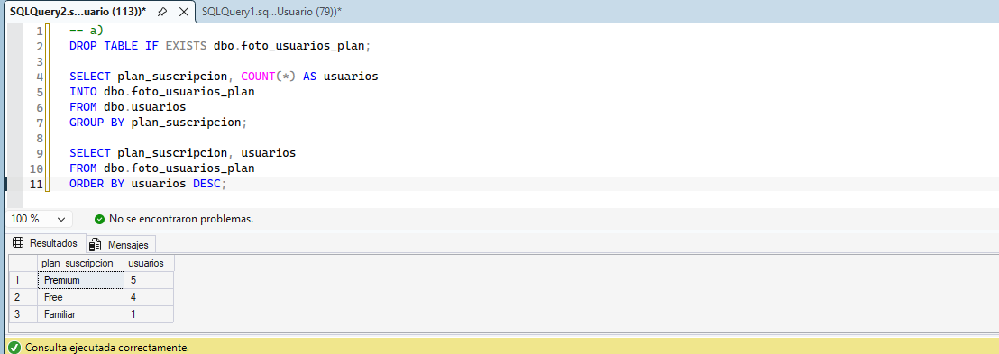

Figura 15. Foto del recuento por plan

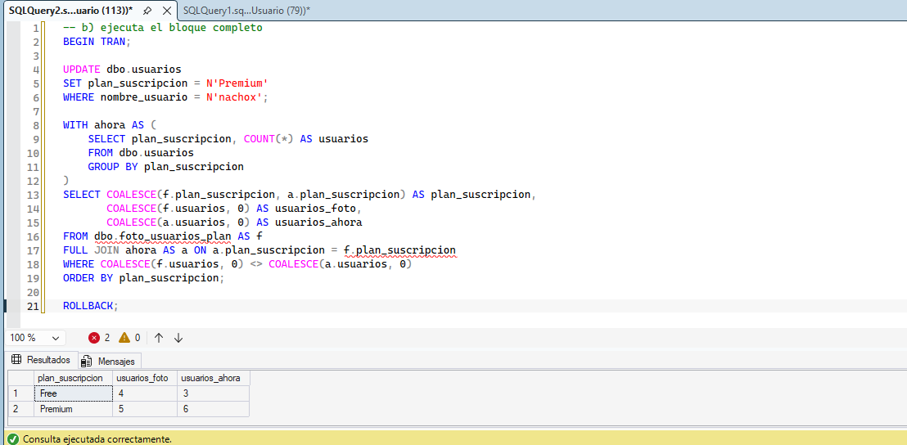

Figura 16. Planes cuya cifra cambia dentro de la transacción

### 1.14 Ejercicio 13. Ranking de artistas con intercambio

*Construir ranking_artistas_nueva, validarla y sustituir ranking_artistas dentro de una transacción con su clave primaria.*

Script: [`sql/s1_ej13.sql`](sql/s1_ej13.sql)

```sql
DROP TABLE IF EXISTS dbo.ranking_artistas_nueva;

SELECT a.artista_id,
       a.nombre                     AS artista,
       COUNT(*)                     AS reproducciones_validas,
       COUNT(DISTINCT r.usuario_id) AS oyentes
INTO dbo.ranking_artistas_nueva
FROM dbo.reproducciones AS r
JOIN dbo.canciones AS c ON c.cancion_id = r.cancion_id
JOIN dbo.artistas  AS a ON a.artista_id = c.artista_id
WHERE r.tipo_contenido = N'Canción'
  AND r.segundos_escuchados >= 30
GROUP BY a.artista_id, a.nombre;

ALTER TABLE dbo.ranking_artistas_nueva
ALTER COLUMN artista_id int NOT NULL;
GO

-- Validación
SELECT (SELECT COUNT(*) FROM dbo.ranking_artistas_nueva) AS filas,
       (SELECT COUNT(*)
        FROM (SELECT artista_id FROM dbo.ranking_artistas_nueva
              GROUP BY artista_id HAVING COUNT(*) > 1) AS rep) AS ids_repetidos;

-- Intercambio, solo si la validación es correcta
IF (SELECT COUNT(*) FROM dbo.ranking_artistas_nueva) > 0
   AND NOT EXISTS (SELECT artista_id FROM dbo.ranking_artistas_nueva
                   GROUP BY artista_id HAVING COUNT(*) > 1)
BEGIN
    BEGIN TRAN;
        DROP TABLE IF EXISTS dbo.ranking_artistas;
        EXEC sp_rename N'dbo.ranking_artistas_nueva', N'ranking_artistas';
        ALTER TABLE dbo.ranking_artistas
        ADD CONSTRAINT PK_ranking_artistas PRIMARY KEY (artista_id);
    COMMIT;
END
ELSE
    PRINT N'Validación fallida: no se sustituye ranking_artistas';
GO

SELECT artista, reproducciones_validas, oyentes
FROM dbo.ranking_artistas
ORDER BY reproducciones_validas DESC, artista;
```

La tabla nueva se construye con otro nombre mientras la app sigue leyendo la anterior. Declaré artista_id como NOT NULL de forma explícita, porque la clave primaria lo exige.

En lugar de validar a ojo, metí la sustitución en un IF: solo se hace el intercambio si la tabla tiene filas y ningún identificador repetido. La clave primaria se crea después del DROP porque el nombre PK_ranking_artistas lo tenía la tabla antigua. Los GO separan la creación del uso, para que SQL Server no compile el lote con la estructura anterior.

Ejecuté el script completo dos veces. La captura es de la segunda: 8 filas, 0 repetidos y el ranking esperado. Las marcas rojas del editor son de IntelliSense, que no conoce aún las tablas recién creadas; la ejecución terminó sin errores.

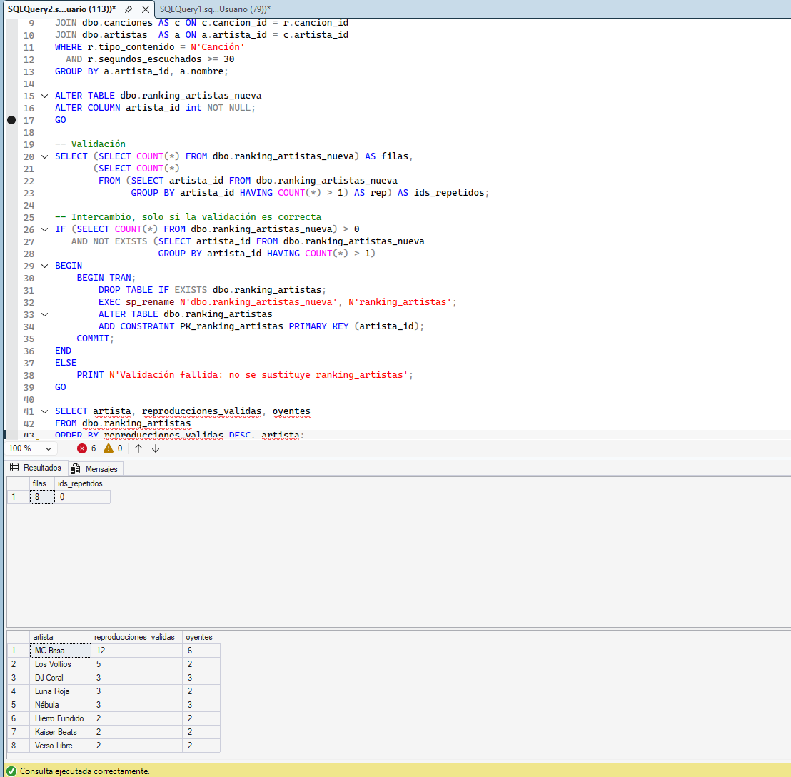

Figura 17. Validación y ranking tras la segunda ejecución

## 2. Sesión 2 · Tablas temporales

Trabajé toda la sesión en la misma ventana de SSMS, salvo en el ejercicio 8, que necesita una segunda sesión. Ningún ejercicio crea objetos permanentes en SonoraDB: las tablas de trabajo viven en tempdb y desaparecen al cerrar la sesión.

### 2.1 Punto de partida

*Crear los lotes stg_usuarios_2309 y stg_canciones_2509 y comprobar el punto de partida.*

Script: [`sql/s2_prep.sql`](sql/s2_prep.sql)

```sql
USE SonoraDB;
GO

-- Lote de altas de usuarios del 23/09
DROP TABLE IF EXISTS dbo.stg_usuarios_2309;

CREATE TABLE dbo.stg_usuarios_2309 (
    usuario_id        int,
    nombre_usuario    nvarchar(50),
    email             nvarchar(150),
    pais              char(2),
    plan_suscripcion  nvarchar(20),
    fecha_alta        date
);

INSERT INTO dbo.stg_usuarios_2309
    (usuario_id, nombre_usuario, email, pais, plan_suscripcion, fecha_alta) VALUES
(10, N'kiara_perreo', N'kiara.perreo@mail.com', 'PR', N'Premium',  '2026-09-21'),
(11, N'teo.bass',     N'teo.bass@mail.com',     'ES', N'Free',     '2026-09-22'),
(12, N'ines_wave',    N'ines.wave@mail.com',    'CO', N'Premium',  '2026-09-22'),
(12, N'ines_wave',    N'ines.wave@mail.com',    'CO', N'Premium',  '2026-09-22'),
(13, N'rober.mx',     N'rober.mx@mail.com',     'MX', N'Premiun',  '2026-09-23'),
(14, N'cami_ar',      NULL,                     'AR', N'Familiar', '2026-09-23'),
(15, N'lola.pop',     N'lola.pop@mail.com',     'ES', N'Family',   '2026-09-23'),
(16, N'max_techno',   N'max.techno@mail.com',   'CO', N'Free',     '2026-09-23');
GO

-- Lote de novedades de catálogo
DROP TABLE IF EXISTS dbo.stg_canciones_2509;

CREATE TABLE dbo.stg_canciones_2509 (
    cancion_id         int,
    titulo             nvarchar(150),
    artista_id         int,
    genero_id          int,
    duracion_seg       int,
    fecha_lanzamiento  date
);

INSERT INTO dbo.stg_canciones_2509
    (cancion_id, titulo, artista_id, genero_id, duracion_seg, fecha_lanzamiento) VALUES
(114, N'Sin Cobertura',  5,  7,  175, '2026-09-18'),
(116, N'Órbita',         9,  2,  192, '2026-09-25'),
(117, N'Asfalto Mojado', 8,  8,  221, '2026-09-25'),
(117, N'Asfalto Mojado', 8,  8,  221, '2026-09-25'),
(118, N'Voltaje',        4,  9,  0,   '2026-09-25'),
(119, N'Bruma',          15, 11, 240, '2026-09-25'),
(120, N'Cumbia Digital', 7,  11, 263, '2026-09-25');
GO

-- Comprobación
SELECT (SELECT COUNT(*) FROM dbo.reproducciones)     AS reproducciones,
       (SELECT COUNT(*) FROM dbo.usuarios)           AS usuarios,
       (SELECT COUNT(*) FROM dbo.canciones)          AS canciones,
       (SELECT COUNT(*) FROM dbo.stg_usuarios_2309)  AS lote_altas,
       (SELECT COUNT(*) FROM dbo.stg_canciones_2509) AS lote_canciones;
```

Las cargas de reproducciones y usuarios ya estaban hechas desde la sesión anterior, así que de este script solo hacía falta la parte que crea los dos lotes nuevos. Este paso sustituye la tabla stg_usuarios_2309 vacía que creé en el ejercicio 3 de la sesión 1. La comprobación da 43, 10, 15, 8 y 7, que es el punto de partida pedido.

Toda la sesión la trabajé en la misma ventana de SSMS, porque las tablas temporales solo viven mientras la sesión sigue abierta.

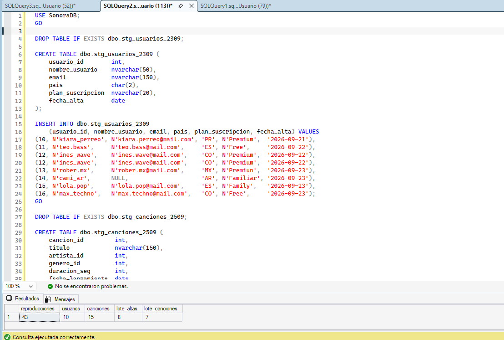

Figura 18. Comprobación del punto de partida de la sesión 2

### 2.2 Tabla base #validas_semana

*Guardar las reproducciones válidas de la semana de análisis en una tabla temporal que usan varios ejercicios.*

Script: [`sql/s2_base.sql`](sql/s2_base.sql)

```sql
DROP TABLE IF EXISTS #validas_semana;

SELECT r.reproduccion_id, r.usuario_id, r.cancion_id, r.fecha_hora,
       r.segundos_escuchados, r.dispositivo
INTO #validas_semana
FROM dbo.reproducciones AS r
WHERE r.tipo_contenido = N'Canción'
  AND r.segundos_escuchados >= 30
  AND r.fecha_hora >= '2026-09-16'
  AND r.fecha_hora <  '2026-09-23';
```

La regla de negocio (canción, al menos 30 segundos y semana del 16 al 22 de septiembre) queda escrita en un único sitio. La tabla se crea con 22 filas en tempdb y la reutilizan los ejercicios 6 y 8.

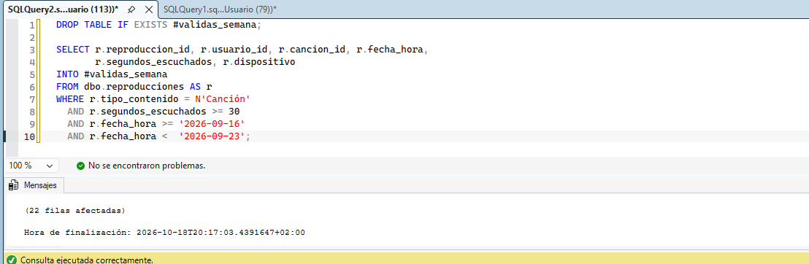

Figura 19. Creación de #validas_semana con 22 filas

### 2.3 Ejercicio 1. Lanzamientos de 2026

*Guardar en #lanzamientos_2026 las canciones lanzadas en 2026 y contar los lanzamientos por artista.*

Script: [`sql/s2_ej01.sql`](sql/s2_ej01.sql)

```sql
DROP TABLE IF EXISTS #lanzamientos_2026;

SELECT c.cancion_id, c.titulo, a.nombre AS artista, c.fecha_lanzamiento
INTO #lanzamientos_2026
FROM dbo.canciones AS c
JOIN dbo.artistas  AS a ON a.artista_id = c.artista_id
WHERE c.fecha_lanzamiento >= '2026-01-01'
  AND c.fecha_lanzamiento <  '2027-01-01';

SELECT artista, COUNT(*) AS lanzamientos
FROM #lanzamientos_2026
GROUP BY artista
ORDER BY lanzamientos DESC, artista;
```

Es el mismo SELECT ... INTO de la sesión anterior, con una tabla # como destino. Filtré el año con un rango semiabierto para que el filtro siga siendo correcto aunque la columna llevara hora. La consulta sobre la tabla temporal devuelve los 5 artistas esperados.

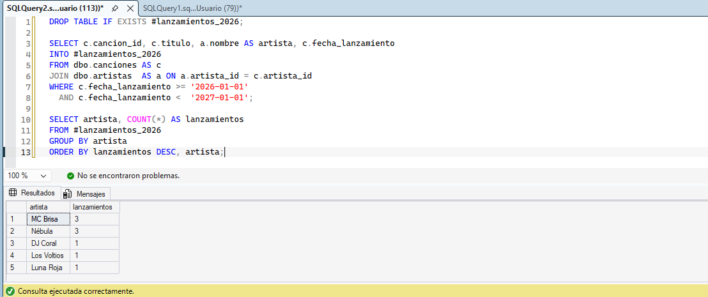

Figura 20. Lanzamientos de 2026 por artista

### 2.4 Ejercicio 2. Usuarios de pago

*Crear #usuarios_pago con CREATE TABLE y clave primaria, llenarla y explicar qué ocurre al repetir el INSERT.*

Script: [`sql/s2_ej02.sql`](sql/s2_ej02.sql)

```sql
DROP TABLE IF EXISTS #usuarios_pago;

CREATE TABLE #usuarios_pago (
    usuario_id        int           NOT NULL PRIMARY KEY,
    nombre_usuario    nvarchar(50)  NOT NULL,
    pais              char(2)       NOT NULL,
    plan_suscripcion  nvarchar(20)  NOT NULL
);

INSERT INTO #usuarios_pago (usuario_id, nombre_usuario, pais, plan_suscripcion)
SELECT usuario_id, nombre_usuario, pais, plan_suscripcion
FROM dbo.usuarios
WHERE plan_suscripcion IN (N'Premium', N'Familiar');

SELECT pais, COUNT(*) AS usuarios_pago
FROM #usuarios_pago
GROUP BY pais
ORDER BY usuarios_pago DESC, pais;

-- Segunda ejecución, solo del INSERT (falla)
INSERT INTO #usuarios_pago (usuario_id, nombre_usuario, pais, plan_suscripcion)
SELECT usuario_id, nombre_usuario, pais, plan_suscripcion
FROM dbo.usuarios
WHERE plan_suscripcion IN (N'Premium', N'Familiar');
```

Definí la estructura con CREATE TABLE para controlar los tipos y poner la clave primaria. La tabla se llena con 6 usuarios y el recuento por país coincide con el esperado.

Al ejecutar otra vez solo el INSERT aparece el error 2627: los seis identificadores ya existen y la clave primaria rechaza los duplicados. Como un INSERT es todo o nada, no entra ninguna fila y la tabla sigue con 6. El nombre de la restricción lo generó SQL Server; en una tabla temporal no conviene ponérselo a mano.

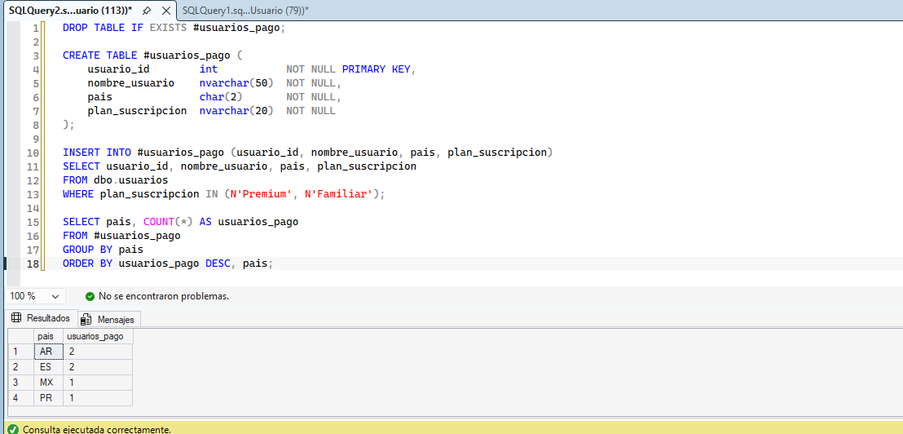

Figura 21. Usuarios de pago por país

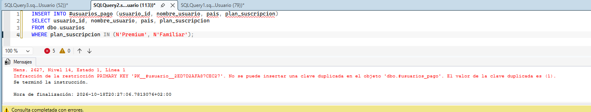

Figura 22. Error 2627 al repetir el INSERT

### 2.5 Ejercicio 3. Script de Hugo

*Explicar por qué el script falla en la segunda ejecución, corregirlo y responder qué pasa en una ventana nueva.*

Script: [`sql/s2_ej03.sql`](sql/s2_ej03.sql)

```sql
-- Script original (falla en la segunda ejecución)
SELECT cancion_id, titulo, duracion_seg
INTO #largas
FROM dbo.canciones
WHERE duracion_seg > 300;

SELECT COUNT(*) AS canciones_largas FROM #largas;

-- Script corregido
DROP TABLE IF EXISTS #largas;

SELECT cancion_id, titulo, duracion_seg
INTO #largas
FROM dbo.canciones
WHERE duracion_seg > 300;

SELECT COUNT(*) AS canciones_largas FROM #largas;
```

La segunda vez aparece el error 2714 (ya hay un objeto llamado #largas). La tabla temporal no desaparece al terminar el script, sino al cerrar la sesión, así que en la misma ventana sigue existiendo y el SELECT ... INTO no puede volver a crearla.

La corrección es anteponer DROP TABLE IF EXISTS #largas. Así el script devuelve 4 en cualquier ejecución.

En una ventana nueva el script original no falla la primera vez. Cada ventana es una sesión distinta con sus propias tablas temporales, y en esa sesión #largas todavía no existe. Fallaría a partir de la segunda ejecución en esa misma ventana.

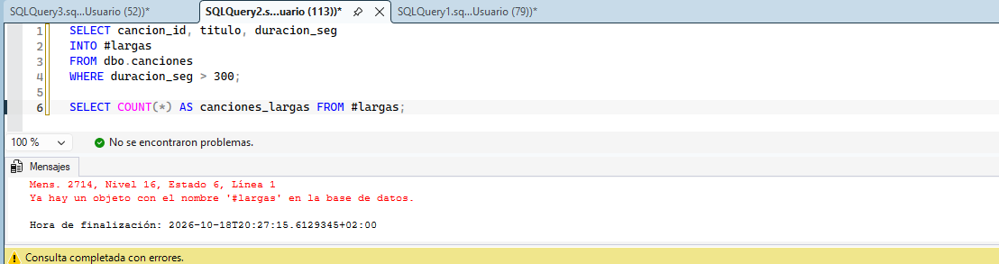

Figura 23. Error 2714 con el script original

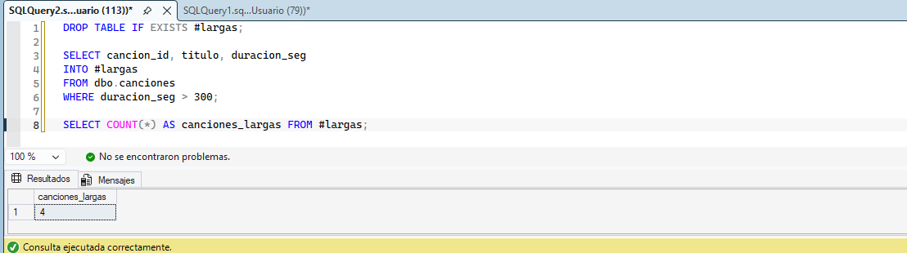

Figura 24. Script corregido, re-ejecutable

### 2.6 Ejercicio 4. Alcance de # y @

*Predecir qué devuelve cada uno de los tres lotes y comprobarlo.*

Script: [`sql/s2_ej04.sql`](sql/s2_ej04.sql)

```sql
DROP TABLE IF EXISTS #paises;

CREATE TABLE #paises (pais char(2) NOT NULL);
DECLARE @paises TABLE (pais char(2) NOT NULL);

INSERT INTO #paises (pais) VALUES ('ES'), ('MX');
INSERT INTO @paises (pais) VALUES ('ES'), ('MX');

SELECT COUNT(*) AS a FROM #paises;
SELECT COUNT(*) AS b FROM @paises;
GO

SELECT COUNT(*) AS c FROM #paises;
SELECT COUNT(*) AS d FROM @paises;
GO

SELECT COUNT(*) AS e FROM #paises;
GO
```

Mi predicción: el primer lote devuelve a = 2 y b = 2, porque la tabla temporal y la variable de tabla existen en ese lote. El segundo lote falla entero, porque @paises dejó de existir en el GO, y SQL Server revisa el lote antes de ejecutarlo; por eso tampoco devuelve c. El tercer lote devuelve e = 2, porque #paises sobrevive a los GO.

La pestaña Mensajes lo confirma: dos inserciones de 2 filas, los resultados a y b, el error 1087 (debe declarar la variable de tabla @paises) en la línea 14, y el resultado e.

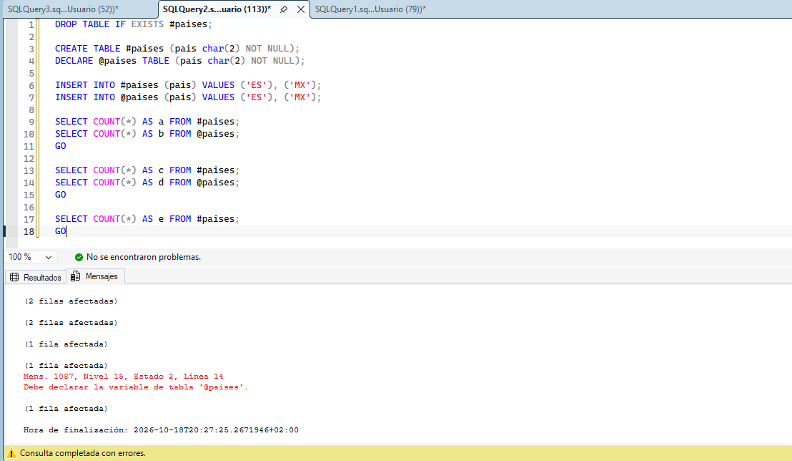

Figura 25. Mensajes de los tres lotes, con el error 1087 en el segundo

### 2.7 Ejercicio 5. Reproducciones válidas del histórico

*Guardar todas las válidas en #validas y responder tres preguntas usando esa tabla.*

Script: [`sql/s2_ej05.sql`](sql/s2_ej05.sql)

```sql
DROP TABLE IF EXISTS #validas;

SELECT reproduccion_id, usuario_id, cancion_id, segundos_escuchados, dispositivo
INTO #validas
FROM dbo.reproducciones
WHERE tipo_contenido = N'Canción'
  AND segundos_escuchados >= 30;

-- a)
SELECT u.pais,
       COUNT(*) AS reproducciones,
       CAST(SUM(v.segundos_escuchados) / 60.0 AS decimal(6,1)) AS minutos
FROM #validas AS v
JOIN dbo.usuarios AS u ON u.usuario_id = v.usuario_id
GROUP BY u.pais
ORDER BY reproducciones DESC;

-- b)
SELECT c.titulo
FROM dbo.canciones AS c
WHERE NOT EXISTS (SELECT 1 FROM #validas AS v WHERE v.cancion_id = c.cancion_id)
ORDER BY c.titulo;

-- c)
SELECT u.nombre_usuario, u.plan_suscripcion
FROM dbo.usuarios AS u
WHERE NOT EXISTS (SELECT 1 FROM #validas AS v WHERE v.usuario_id = u.usuario_id);
```

El filtro de validez se aplica una sola vez y las tres consultas leen la tabla temporal. Para b) y c) usé NOT EXISTS en lugar de NOT IN, que es seguro aunque la subconsulta devolviera nulos. Las canciones sin válidas son Latido y Sin Cobertura, y el único usuario sin válidas es vale_indie.

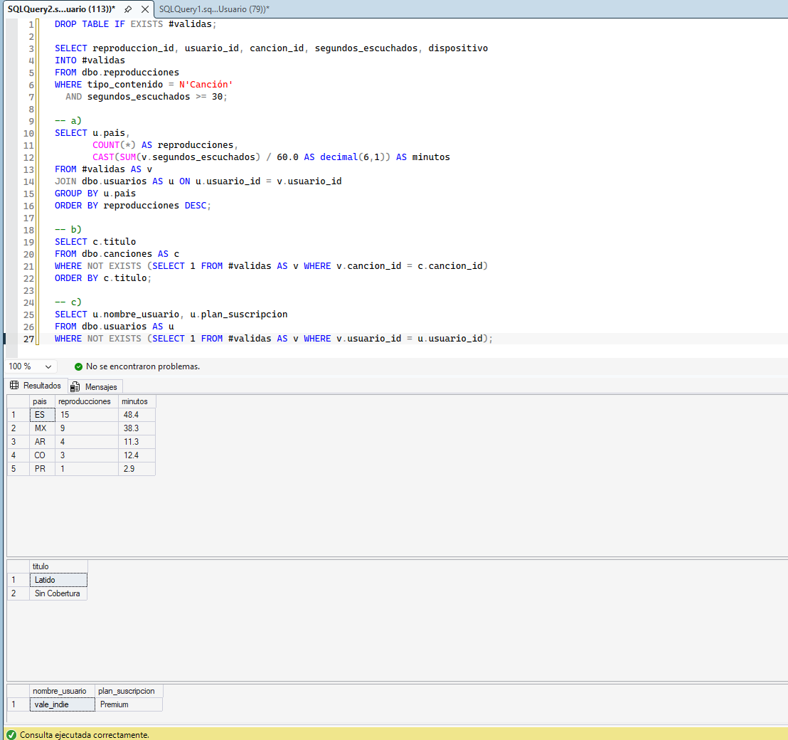

Figura 26. Respuestas a), b) y c) sobre #validas

### 2.8 Ejercicio 6. Royalties con @tarifas

*Guardar las tarifas en una variable de tabla y calcular minutos, tarifa e importe por plan.*

Script: [`sql/s2_ej06.sql`](sql/s2_ej06.sql)

```sql
DROP TABLE IF EXISTS #validas_semana;

SELECT r.reproduccion_id, r.usuario_id, r.cancion_id, r.fecha_hora,
       r.segundos_escuchados, r.dispositivo
INTO #validas_semana
FROM dbo.reproducciones AS r
WHERE r.tipo_contenido = N'Canción'
  AND r.segundos_escuchados >= 30
  AND r.fecha_hora >= '2026-09-16'
  AND r.fecha_hora <  '2026-09-23';
GO

DECLARE @tarifas TABLE (
    plan_suscripcion  nvarchar(20)  NOT NULL PRIMARY KEY,
    euros_minuto      decimal(4,2)  NOT NULL
);

INSERT INTO @tarifas (plan_suscripcion, euros_minuto) VALUES
(N'Premium', 0.08), (N'Familiar', 0.08), (N'Free', 0.02);

SELECT u.plan_suscripcion,
       CAST(SUM(v.segundos_escuchados) / 60.0 AS decimal(6,1)) AS minutos,
       t.euros_minuto,
       CAST(CAST(SUM(v.segundos_escuchados) / 60.0 AS decimal(6,1)) * t.euros_minuto
            AS decimal(6,2)) AS importe
FROM #validas_semana AS v
JOIN dbo.usuarios AS u ON u.usuario_id = v.usuario_id
JOIN @tarifas     AS t ON t.plan_suscripcion = u.plan_suscripcion
GROUP BY u.plan_suscripcion, t.euros_minuto
ORDER BY importe DESC;
```

Las tarifas no están en ninguna tabla de Sonora y son solo tres filas, que es el caso de uso de una variable de tabla. El DECLARE, el INSERT y la consulta van en el mismo lote. Rehice #validas_semana al principio, separada con GO, para que el script funcione aunque la tabla ya no exista en la sesión.

El importe se calcula sobre los minutos ya redondeados a un decimal, que es como los presenta Finanzas. Así salen exactamente 3,16, 0,59 y 0,45 euros.

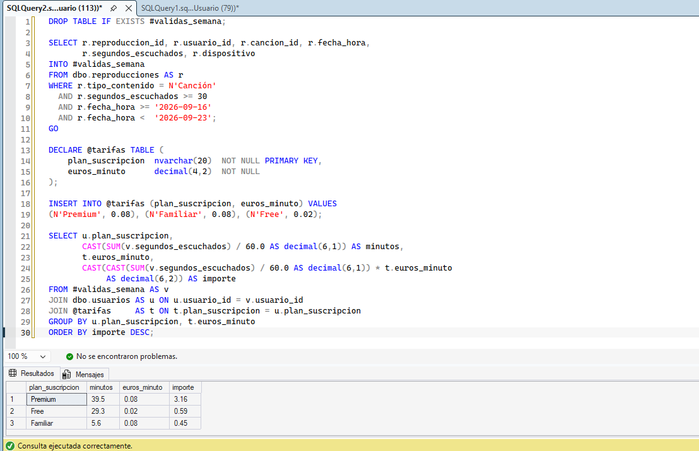

Figura 27. Minutos, tarifa e importe por plan

### 2.9 Ejercicio 7. Catálogo por formato

*Copiar el catálogo en #catalogo, añadir y rellenar la columna formato, contar y borrar las cortas.*

Script: [`sql/s2_ej07.sql`](sql/s2_ej07.sql)

```sql
DROP TABLE IF EXISTS #catalogo;

SELECT cancion_id, titulo, duracion_seg
INTO #catalogo
FROM dbo.canciones;

ALTER TABLE #catalogo ADD formato nvarchar(10) NULL;
GO

UPDATE #catalogo
SET formato = CASE WHEN duracion_seg < 180  THEN N'Corta'
                   WHEN duracion_seg <= 300 THEN N'Estándar'
                   ELSE N'Larga' END;

SELECT formato, COUNT(*) AS canciones
FROM #catalogo
GROUP BY formato
ORDER BY canciones DESC, formato;

DELETE FROM #catalogo WHERE formato = N'Corta';

SELECT (SELECT COUNT(*) FROM #catalogo)      AS filas_catalogo_temporal,
       (SELECT COUNT(*) FROM dbo.canciones)  AS filas_canciones;
```

El GO después del ALTER TABLE es necesario: SQL Server revisa el lote antes de ejecutarlo, y en ese momento la columna formato todavía no existe. El recuento da 7 estándar, 4 cortas y 4 largas.

Tras borrar las cortas, #catalogo queda con 11 filas y canciones sigue con 15. Todo el trabajo se hizo sobre la copia temporal sin tocar la tabla real. Las marcas rojas del editor son de IntelliSense, que no conoce la columna añadida.

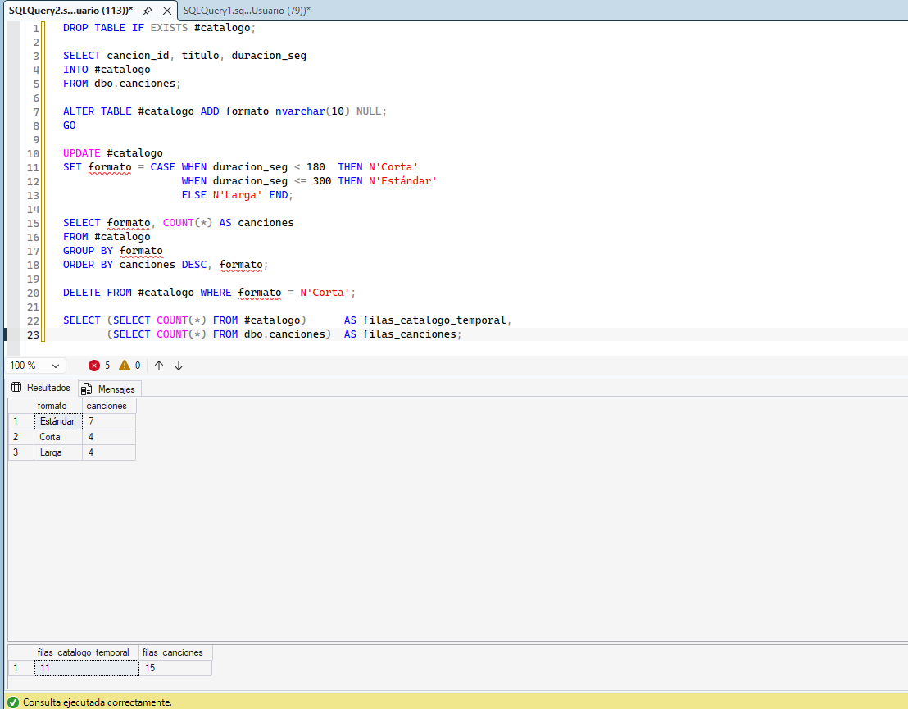

Figura 28. Recuento por formato y filas tras el borrado

### 2.10 Ejercicio 8. Tabla global ##artistas_semana

*Publicar las cifras por artista en una tabla temporal global, consultarla desde otra ventana y responder dos preguntas.*

Script: [`sql/s2_ej08.sql`](sql/s2_ej08.sql)

```sql
-- Ventana 1
DROP TABLE IF EXISTS ##artistas_semana;

SELECT a.nombre AS artista,
       COUNT(*) AS reproducciones,
       CAST(SUM(v.segundos_escuchados) / 60.0 AS decimal(6,1)) AS minutos
INTO ##artistas_semana
FROM #validas_semana AS v
JOIN dbo.canciones AS c ON c.cancion_id = v.cancion_id
JOIN dbo.artistas  AS a ON a.artista_id = c.artista_id
GROUP BY a.nombre;

-- Ventana 2
SELECT artista, reproducciones, minutos
FROM ##artistas_semana
WHERE reproducciones > 1
ORDER BY reproducciones DESC, artista;
```

La tabla global se crea en la primera ventana con 8 filas. Desde una segunda ventana, que es otra sesión, la consulta la encuentra sin problema y devuelve los 4 artistas con más de una reproducción. Con una tabla local esa consulta habría dado el error 208.

a) Si cierro la primera ventana, termina la sesión que creó la tabla y SQL Server la borra. La consulta de Nuria pasaría a fallar con el error 208 (nombre de objeto no válido).

b) Una tabla global la puede leer, modificar o borrar cualquier sesión conectada a la instancia, sin ningún control de permisos sobre ella. Poner ahí los emails de los oyentes expondría datos personales a cualquiera con acceso a la instancia. Además, para la reunión con los sellos basta con las cifras agregadas.

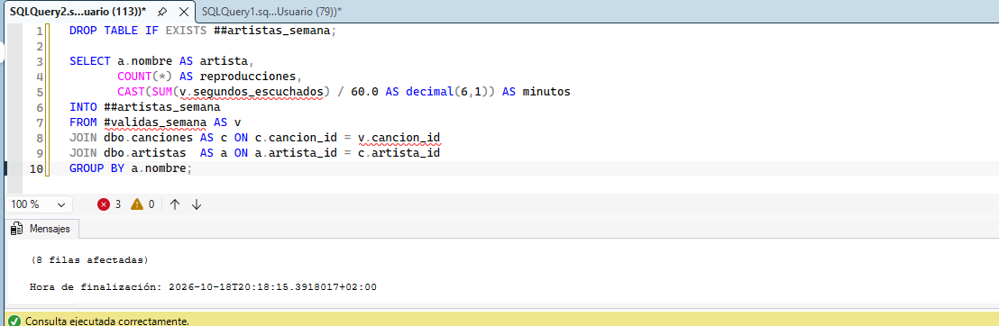

Figura 29. Creación de ##artistas_semana en la primera ventana

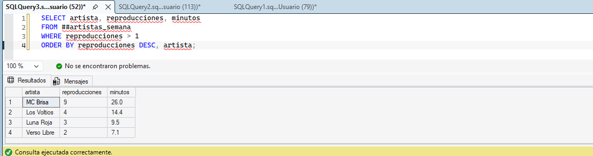

Figura 30. Consulta desde la segunda ventana

### 2.11 Ejercicio 9. Transacciones: # frente a @

*Predecir qué devuelven las dos consultas finales tras el ROLLBACK y comprobarlo.*

Script: [`sql/s2_ej09.sql`](sql/s2_ej09.sql)

```sql
DROP TABLE IF EXISTS #precios;

CREATE TABLE #precios (
    plan_suscripcion  nvarchar(20)  NOT NULL PRIMARY KEY,
    precio_mes        decimal(5,2)  NOT NULL
);

INSERT INTO #precios (plan_suscripcion, precio_mes)
VALUES (N'Premium', 10.99), (N'Familiar', 17.99);

DECLARE @cambios TABLE (
    plan_suscripcion  nvarchar(20)  NOT NULL,
    precio_nuevo      decimal(5,2)  NOT NULL
);

BEGIN TRAN;

    UPDATE #precios
    SET precio_mes = 11.99
    WHERE plan_suscripcion = N'Premium';

    INSERT INTO @cambios (plan_suscripcion, precio_nuevo)
    VALUES (N'Premium', 11.99);

ROLLBACK;

SELECT plan_suscripcion, precio_mes FROM #precios ORDER BY plan_suscripcion;

SELECT plan_suscripcion, precio_nuevo FROM @cambios;
```

Mi predicción: #precios vuelve a tener Premium a 10,99, porque las tablas temporales participan en las transacciones y el ROLLBACK deshace el UPDATE. En cambio @cambios conserva la fila de Premium a 11,99, porque las variables de tabla no participan en las transacciones.

La ejecución lo confirma. Este comportamiento sirve para dejar registro de lo que pasaba dentro de una transacción aunque luego se deshaga.

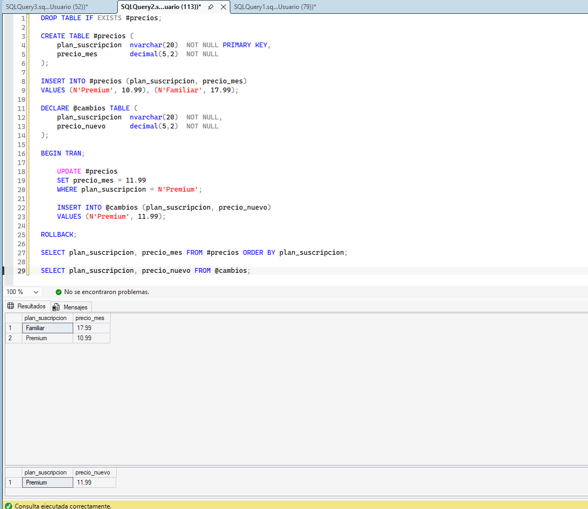

Figura 31. Precios tras el ROLLBACK y contenido de @cambios

### 2.12 Ejercicio 10. Árbol de géneros

*Calcular una vez el género principal de cada género en #arbol_generos y usarlo en dos consultas.*

Script: [`sql/s2_ej10.sql`](sql/s2_ej10.sql)

```sql
DROP TABLE IF EXISTS #arbol_generos;

WITH arbol AS (
    SELECT genero_id, genero_id AS raiz_id
    FROM dbo.generos
    WHERE genero_padre_id = (SELECT genero_id FROM dbo.generos WHERE genero_padre_id IS NULL)

    UNION ALL

    SELECT g.genero_id, a.raiz_id
    FROM dbo.generos AS g
    JOIN arbol AS a ON g.genero_padre_id = a.genero_id
)
SELECT a.genero_id, gp.nombre AS genero_principal
INTO #arbol_generos
FROM arbol AS a
JOIN dbo.generos AS gp ON gp.genero_id = a.raiz_id;

-- a)
SELECT ag.genero_principal, COUNT(*) AS canciones
FROM dbo.canciones AS c
JOIN #arbol_generos AS ag ON ag.genero_id = c.genero_id
GROUP BY ag.genero_principal
ORDER BY canciones DESC, ag.genero_principal;

-- b)
SELECT ag.genero_principal,
       COUNT(*) AS reproducciones,
       CAST(SUM(r.segundos_escuchados) / 60.0 AS decimal(6,1)) AS minutos
FROM dbo.reproducciones AS r
JOIN dbo.canciones      AS c  ON c.cancion_id = r.cancion_id
JOIN #arbol_generos     AS ag ON ag.genero_id = c.genero_id
WHERE r.tipo_contenido = N'Canción'
  AND r.segundos_escuchados >= 30
GROUP BY ag.genero_principal
ORDER BY reproducciones DESC;
```

El ancla de la CTE son los hijos directos de Música, que se asignan a sí mismos como raíz, y la parte recursiva hereda esa raíz hacia abajo. El resultado (12 filas) se guarda una sola vez en #arbol_generos y las dos consultas lo usan como una tabla más, sin repetir la recursión. Ambos resultados coinciden con los esperados.

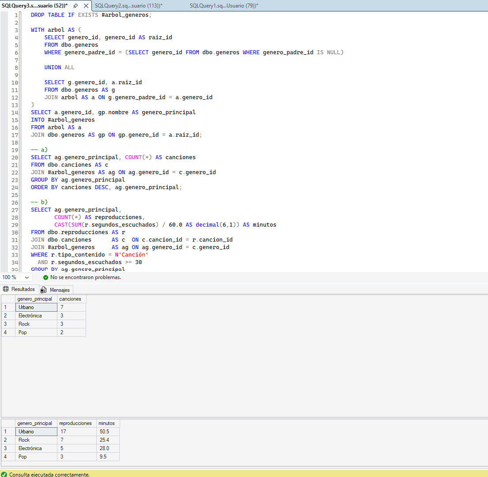

Figura 32. Canciones y reproducciones por género principal

### 2.13 Ejercicio 11. Aterrizar el lote de novedades

*Aterrizar stg_canciones_2509 en #novedades sin duplicados, comprobar repetidos y descartar lo que ya existe.*

Script: [`sql/s2_ej11.sql`](sql/s2_ej11.sql)

```sql
DROP TABLE IF EXISTS #novedades;

SELECT DISTINCT cancion_id, titulo, artista_id, genero_id, duracion_seg, fecha_lanzamiento
INTO #novedades
FROM dbo.stg_canciones_2509;

SELECT cancion_id, COUNT(*) AS veces
FROM #novedades
GROUP BY cancion_id
HAVING COUNT(*) > 1;

DELETE FROM #novedades
WHERE EXISTS (SELECT 1 FROM dbo.canciones AS c WHERE c.cancion_id = #novedades.cancion_id);

SELECT cancion_id, titulo, artista_id, duracion_seg
FROM #novedades
ORDER BY cancion_id;
```

El DISTINCT elimina la fila 117 repetida, que era idéntica en todas las columnas: de 7 filas recibidas aterrizan 6, y la comprobación de identificadores repetidos sale vacía.

Después descarto Sin Cobertura (114), que ya está en el catálogo. En el DELETE la subconsulta se refiere a la tabla temporal como #novedades.cancion_id; si escribiera solo cancion_id, la condición compararía la columna consigo misma y vaciaría el lote. Quedan las 5 novedades esperadas.

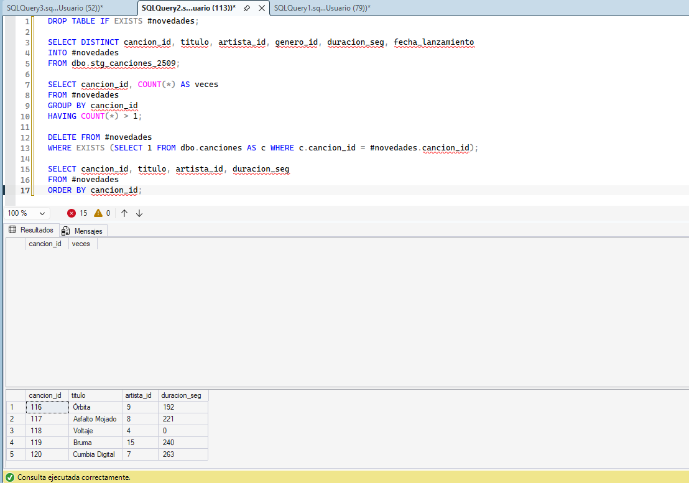

Figura 33. Repetidos (vacío) y novedades restantes

### 2.14 Ejercicio 12. Validar y cargar las novedades

*Apartar en #novedades_rechazadas las canciones que incumplen las dos reglas y cargar el resto en una transacción que se deshace.*

Script: [`sql/s2_ej12.sql`](sql/s2_ej12.sql)

```sql
DROP TABLE IF EXISTS #novedades;

SELECT DISTINCT cancion_id, titulo, artista_id, genero_id, duracion_seg, fecha_lanzamiento
INTO #novedades
FROM dbo.stg_canciones_2509;

DELETE FROM #novedades
WHERE EXISTS (SELECT 1 FROM dbo.canciones AS c WHERE c.cancion_id = #novedades.cancion_id);

DROP TABLE IF EXISTS #novedades_rechazadas;

CREATE TABLE #novedades_rechazadas (
    cancion_id  int            NOT NULL,
    titulo      nvarchar(150)  NULL,
    motivo      nvarchar(60)   NOT NULL
);

-- Regla 1: el artista debe existir
INSERT INTO #novedades_rechazadas (cancion_id, titulo, motivo)
SELECT cancion_id, titulo, N'Artista inexistente'
FROM #novedades
WHERE NOT EXISTS (SELECT 1 FROM dbo.artistas AS a WHERE a.artista_id = #novedades.artista_id);

DELETE FROM #novedades
WHERE NOT EXISTS (SELECT 1 FROM dbo.artistas AS a WHERE a.artista_id = #novedades.artista_id);

-- Regla 2: duración mayor que cero
INSERT INTO #novedades_rechazadas (cancion_id, titulo, motivo)
SELECT cancion_id, titulo, N'Duración no válida'
FROM #novedades
WHERE duracion_seg <= 0;

DELETE FROM #novedades
WHERE duracion_seg <= 0;

SELECT cancion_id, titulo, motivo
FROM #novedades_rechazadas
ORDER BY cancion_id;

-- Carga dentro de transacción
BEGIN TRAN;

    INSERT INTO dbo.canciones (cancion_id, titulo, artista_id, genero_id, duracion_seg, fecha_lanzamiento)
    SELECT n.cancion_id, n.titulo, n.artista_id, n.genero_id, n.duracion_seg, n.fecha_lanzamiento
    FROM #novedades AS n
    WHERE NOT EXISTS (SELECT 1 FROM dbo.canciones AS c WHERE c.cancion_id = n.cancion_id);

    SELECT COUNT(*) AS canciones_en_transaccion FROM dbo.canciones;

ROLLBACK;

SELECT COUNT(*) AS canciones_tras_rollback FROM dbo.canciones;
```

Hice el script autocontenido: vuelve a aterrizar el lote al principio, de modo que se puede ejecutar varias veces y siempre parte del mismo estado.

Cada regla usa la misma condición dos veces, una para apartar las filas con su motivo y otra para quitarlas del lote, y se aplican en el orden fijado. Bruma (119) se rechaza porque el artista 15 no existe, y Voltaje (118) porque dura 0 segundos.

Las 3 canciones limpias se cargan dentro de una transacción: el catálogo pasa a tener 18 filas y, tras el ROLLBACK, vuelve a 15. El NOT EXISTS de la carga mantiene el paso idempotente aunque se ejecutara suelto. Las cifras cuadran: 7 recibidas = 1 duplicada + 1 ya existente + 2 rechazadas + 3 cargadas.

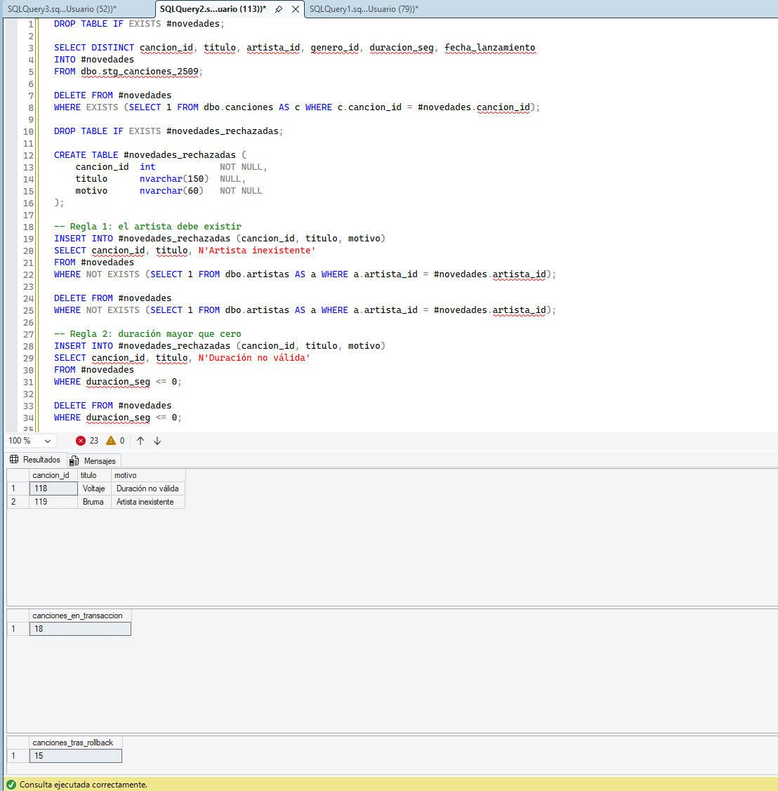

Figura 34. Rechazos y recuento de canciones dentro y fuera de la transacción
